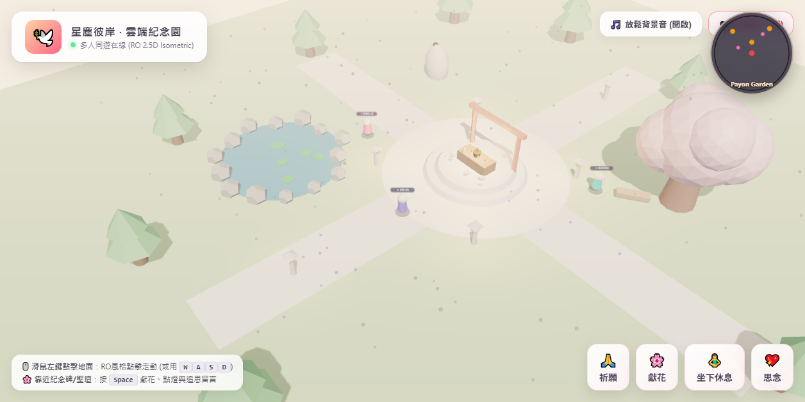
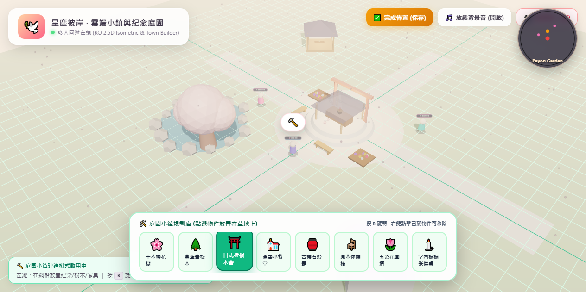
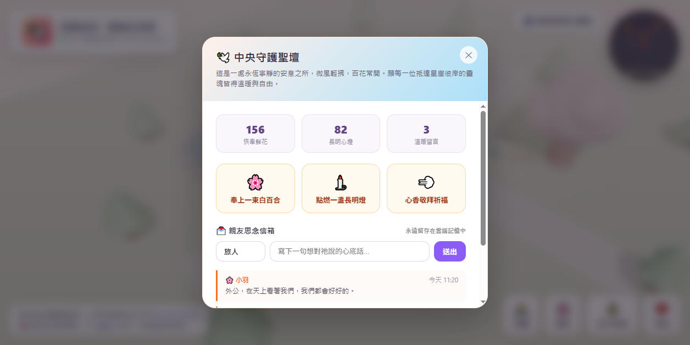

# 🌸 Reien (霊園) ‧ 2.5D 溫馨線上靈園 & 庭園小鎮

> 一個重現《仙境傳說 RO》與《動物森友會》溫暖治癒風格的 2.5D 偽 3D 線上靈園、虛擬追思園與自建庭園小鎮。  
> 具備免安裝瀏覽器秒開、點擊走動、聖壇獻花點燈、親友追思信箱、以及完整的**自由建造庭園小鎮系統**。

[](CHANGELOG.md)
[](.github/workflows/ci-deploy.yml)
[](https://karst10607.github.io/reien/)
[](https://karst10607.github.io/reien/)

### 🌐 線上即時參訪網址 (Live Visit Link)
👉 **[https://karst10607.github.io/reien/](https://karst10607.github.io/reien/)**  
*(手機、平板、電腦打開瀏覽器 3 秒內直接進入，免下載任何 App 即可漫步、獻花、點燈與自建花園)*

---

## 📸 實機畫面 (Live Screenshots)

### 1. 靈園與小鎮全景 (World Overview)

* **RO 經典 45° 斜俯視角 (Isometric)**：低多邊形（Low-poly）溫馨造景、石板路徑、中央守護聖壇、靜心蓮池與千本櫻花樹。
* **動態粒子氛圍**：空中飄拂的粉白落櫻花瓣粒子與螢火蟲。
* **RO 操作模式**：滑鼠點擊地面顯示經典綠色脈衝光圈，角色平滑前往；右下角具備坐下休息 (`/sit`)、祈願與思念表情。
* **雷達小地圖**：右上角即時顯示周圍景點與漫步旅人。

### 2. 庭園與小鎮建造模式 (Town & Garden Builder)

* **對齊網格系統 (Grid Snap)**：開啟建造模式後，地面亮起綠色網格，滑鼠游標帶有半透明預覽模型。
* **物件目錄庫 (Object Palette)**：
  * 🌸 **千本櫻花樹**（自帶花瓣飄落粒子）
  * 🌲 **高聳青松木**
  * ⛩️ **日式祈福木舍**（面向鏡頭半開放，內有暖心微光）
  * ⛪ **溫馨小教堂 / 靈骨紀念堂**
  * 🏮 **古樸石燈籠**（自帶夜間照明點光源）
  * 🪑 **原木休憩椅**
  * 🌷 **五彩花圃壇**
  * 🕯️ **室內榻榻米供桌**
* **操作與保存**：按鍵盤 <kbd>R</kbd> 旋轉方向，左鍵放置，右鍵拆除回收，所有擺放進度自動持久化儲存。

### 3. 中央守護聖壇追思面板 (Memorial Interaction Modal)

* **供奉互動**：供奉鮮花（聖壇前生成 3D 盛開花朵）、點燃長明燈（增加跳動暖光）、心香敬拜。
* **親友思念信箱**：親友可在此輸入暱稱並留下一句心底話，資料永久釘在雲端回憶牆上。

---

## 🚀 快速開始 (Quick Start)

### 方式 1：本地快速運行
本專案為零依賴原生 Web 架構，只需要 Python 即可在本地啟動：

```bash
# 1. 複製專案
git clone https://github.com/karst10607/reien.git
cd reien

# 2. 啟動本機伺服器
python server.py

# 3. 在瀏覽器打開
http://localhost:8088
```

### 方式 2：GitHub Pages 免費全球線上託管 (1 鍵上線)
1. 前往 GitHub 本專案頁面的 **Settings** -> **Pages**。
2. 在 **Branch** 選取 `main`，資料夾選取 `/ (root)`，點擊 **Save**。
3. 稍候片刻，全世界的親友即可透過 `https://karst10607.github.io/reien/` 免安裝直接進入靈園！

---

## 🛠️ 技術架構與規劃

本專案採用 **Monorepo（單一多模組儲存庫）** 策略設計，以便未來進行 Three.js 與 Godot 4 的跨框架比較與無痛遷移：

```
reien/
├── index.html               # Three.js 2.5D 前端客戶端 (支援 GitHub Pages 秒開)
├── server.py                # 本機測試伺服器腳本
├── docs/
│   ├── architecture_and_evaluation.md   # 完整技術選型、Godot/Rust 對比與 Oracle VPS 評估
│   └── screenshots/                     # 實機展示截圖
│
├── client-godot/            # (規劃中) Godot 4 原生遊戲客戶端 (匯出 PC .exe / Android APK)
└── server/                  # (規劃中) PocketBase / Rust 即時狀態與留言簿後端
```

### 核心技術特點：
1. **WebGL / Three.js 原生秒開**：整包前端核心體積小於 3MB，手機 4G 點開 3 秒內進入，無任何安裝門檻。
2. **多層次色溫光影、4096 樹冠鏤空陰影與木漏れ日 (Komorebi) 光斑**：
   * 3 點主副光源（暖金斜射太陽光 + 冷青天空補光 + 櫻花粉逆光透射）搭配 4 組空間反彈點光源。
   * 丁達爾體積光束散射（God-Rays）與自訂 GLSL **木漏れ日（Komorebi）樹影碎光與漂浮雲影 Shader**，徹底消除白天的平淡單一感。
   * 櫻花與青松具備 3 階層樹冠受光／背光漸層與 `MeshDepthMaterial` 鏤空樹葉陰影。
3. **樹下與進入室內自動 X-Ray 透視（See-Through Occlusion）**：當角色走入日式木造御守所室內或穿梭於櫻花樹／松樹樹冠下方時，遮擋物自動平滑淡化為 `14%–16%` 半透明透視，完整呈現室內榻榻米與供桌細節。
4. **手機直立／橫放零遮擋自適應 UI ＋ 手遊虛擬搖桿**：手機直立與橫放模式自動收合操作說明至右上角 `?` 按鈕，並於左下角提供多點觸控虛擬搖桿。
5. **跨平台震動回饋（手把 Dual-Rumble ＋ 手機 Vibration API）與守護犬「豆豆」**：支援雷雨閃電強震，以及靠近／點擊黃金獵犬「豆豆」時的撒嬌跳躍、汪汪音效與溫柔心跳震動。

---

## 🧪 自動化測試與 CI/CD 流水線 (Automated E2E Test Suite & GitHub Actions)

本專案內建零外部套件依賴的 **Chrome DevTools Protocol (CDP) 端到端自動化測試套件**（`tests/e2e_ci_suite.py`）與 **GitHub Actions CI/CD 自動檢測發佈工作流**（`.github/workflows/ci-deploy.yml`）。每次 Push 或 PR 皆會自動執行以下 **10 項自動化測試案例（TC-01 ~ TC-10）**，全部通過後才自動部署至 GitHub Pages：

| 測試編號 | 測試項目 | 自動化驗證內容 |
| :--- | :--- | :--- |
| **TC-01** | 靜態 HTML 結構與 JS 語法檢測 | 檢查關鍵 DOM 節點完整性，並透過 `node --check` 驗證內嵌腳本 0 語法錯誤 |
| **TC-02** | WebGL 場景啟動與零 Runtime Error | 啟動無頭瀏覽器載入 Three.js 場景，驗證 `window.__REIEN_DIAG__`、紀念碑與遮擋物清單初始化且 0 報錯 |
| **TC-03** | 手機直立模式 (`390×844`) 零遮擋與搖桿檢查 | 驗證 `#normal-help` 預設隱藏不擋畫面、`?` 切換鈕正常展開、左下虛擬搖桿自動顯示且膠囊按鈕不換行 |
| **TC-04** | 手機橫放模式 (`844×390`) 排版與搖桿檢查 | 驗證橫放時頂部與底部工具列不重疊、說明框自動隱藏、虛擬搖桿正常顯示 |
| **TC-05** | 手遊虛擬搖桿拖曳與角色移動測試 | 模擬 Pointer 事件按住並拖曳 `#joystick-zone`，驗證角色世界座標依鏡頭方向平滑移動 |
| **TC-06** | 跨平台震動回饋（手機＋手把）與摸摸「豆豆」 | 攔截 `navigator.vibrate` 與 Gamepad `vibrationActuator.playEffect('dual-rumble')`，驗證摸狗時雙平台震動與跳躍動畫觸發 |
| **TC-07** | 雷雨閃電天氣強震回饋測試 | 切換至 `thunder` 雷雨模式並觸發落雷，驗證手機脈衝與手把強震（`strongMagnitude >= 0.9`） |
| **TC-08** | 白天多層次光影、4096 陰影、丁達爾光束與木漏れ日 | 驗證白天主光／環境光對比度（`>= 7.5x`）、冷暖邊緣逆光、4 組空間反彈光源、4096 陰影貼圖與 Komorebi 雲影碎光強度 |
| **TC-09** | 樹冠與室內建築自動 X-Ray 透視淡化測試 | 將角色傳送至木屋室內與櫻花樹冠下，驗證 `minOccludableAlpha < 0.25` 自動半透明化 |
| **TC-10** | 造鎮建造模式切換與聖壇獻花點燈互動 | 驗證建造模式開關狀態切換、聖壇追思面板開啟與點燃祈福燭光計數器遞增 |
| **TC-11** | 手機直立手遊風格沉浸式頂部選單收合測試 | 驗證手機直立模式下 `#btn-top-hud-toggle` 摺疊頂部面板至 `< 50px`，解鎖 95% 全螢幕無遮擋視角與還原展開 |
| **TC-12** | 藍牙與有線手把雙馬達震動 (Dual-Rumble) 檢測 | 模擬藍牙/有線 Xbox/DualSense 手把連線，驗證 `vibrationActuator.playEffect('dual-rumble')` 與診斷橫幅正常驅動 |

### 在本機執行完整 CI 測試套件 (12 項案例)：
```bash
python tests/e2e_ci_suite.py
```

---

## ☁️ Oracle VPS 伺服器部署指南

* **硬體需求**：
  * **Oracle Cloud Always Free (永久免費層)**：
    * **Ampere A1 (4 OCPU, 24GB RAM, 10TB/月流量)**：可支撐 1,500 ~ 3,000 人同時在線漫步祈願。
* **動靜分離最佳架構**：
  * 靜態 3D 模型與前端託管於 **Cloudflare CDN / GitHub Pages**。
  * Oracle VPS 僅負責處理 **PocketBase / WebSocket** 數據傳輸，VPS 頻寬消耗接近 0。

詳細評估與技術報告請參閱 [docs/architecture_and_evaluation.md](docs/architecture_and_evaluation.md)。

---

## 📜 開源許可
MIT License.
