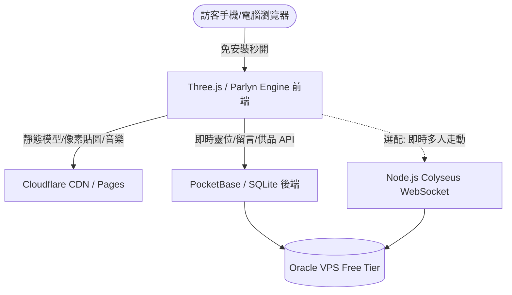

# 🌸 星塵彼岸 ‧ 2.5D 溫馨線上靈園技術評估與開源方案對比報告

> 🌐 **線上即時體驗網址 (Live Demo)**：👉 **[https://karst10607.github.io/reien/](https://karst10607.github.io/reien/)**  
> *(手機、平板、電腦打開瀏覽器 3 秒內直接進入，免下載任何 App 即可漫步、獻花、點燈與自建花園)*

本報告結合了使用者提供的討論記錄（包含日本/台灣線上靈園案例、RO 偽 3D 開源方案、PocketBase CMS 架構）與本地即時運行的 Prototype 實測成果，進行全方位的技術棧與維護體系比較。

---

## 📸 本地模擬世界實機截圖 (Live Prototype)

以下為目前在本地伺服器運行的 2.5D RO 風格線上靈園即時算繪畫面：

### 1. 靈園主世界全景 (World Overview & UI)

> **畫面特點**：
> - **RO 經典 45° 斜俯視角 (Isometric)**：低多邊形（Low-poly）造景，包含中央守護聖壇（鳥居/香爐）、靜心蓮池、千本祈願櫻花巨樹、石燈籠步道。
> - **動態氛圍粒子**：空中隨風飄拂的粉白櫻花落瓣粒子系統與夜間螢火蟲。
> - **RO 操作與 UI**：經典點擊地面波紋光環、右上角 RO 風格雷達小地圖（Payon Garden）、右下角祈願/獻花/坐下休息/思念表情按鈕。

---

### 2. 中央守護聖壇互動面板 (Memorial Interaction Modal)

> **互動亮點**：
> - **追思奉獻**：點擊可供奉鮮花（聖壇前即時生成 3D 盛開花朵）、點燃長明燈（增加跳動暖火光源）、心香祈福。
> - **雲端親友思念信箱**：親友可自訂暱稱並留下悼念字句，資料即時釘在回憶牆上。

---

## ⚖️ 開源技術方案深度橫向評估

依據分享內容所提及的開源路線，以下針對開發難度、訪客體驗、美術資產與維護性進行全面評估：

| 方案 | 核心技術棧 | 網頁首屏速度 | 開發門檻 | 優勢 | 潛在挑戰 | 推薦指數 |
| :--- | :--- | :--- | :--- | :--- | :--- | :--- |
| **方案 A：輕量 WebGL 原生（當前 Prototype 採用）** | **Three.js** / **Parlyn Engine** + 原生 HTML/Vue | **極快 (< 3MB)** 3 秒內秒開 | 中等 | 訪客體驗最佳，長輩與手機點開即玩；UI 可用 Tailwind/CSS 做出高質感毛玻璃效果 | 需手寫基礎相機跟隨與點擊移動邏輯（本專案已完成） | ⭐⭐⭐⭐⭐ (最強烈推薦) |
| **方案 B：開源全能引擎** | **Godot 4.3** (匯出 WebAssembly) | **普通 (20~30MB)** 有載入進度條 | 低至中 | 內建視覺化地圖編輯器，`Sprite3D` 天然支援 `Y-Billboard`，光影與相機碰撞現成 | 手機 Safari 兼容性與首屏 WASM 下載較慢，部分舊手機容易閃退 | ⭐⭐⭐⭐ (適合單機遊戲轉網頁) |
| **方案 C：硬核復刻路線** | **roBrowserLegacy** (WebGL + TS) | **中等 (10~20MB)** | 極高 | 可直接讀取 RO 官方 `.rsw` (地圖)、`.gnd` (地形)、`.spr` / `.act` (角色精靈與動作) | 專案年代久遠、架構肥重，要剝離遊戲戰鬥/數值系統改成單純靈園非常耗費心力 | ⭐⭐ (僅建議提取資產解碼代碼) |

---

## 🏛️ 市面現有專案特色汲取與借鑑

| 參考專案 | 形式 | 可吸收的精華功能 | 融入本作的設計方式 |
| :--- | :--- | :--- | :--- |
| **日本「風の霊」** | Vket Cloud 3D 靈園 | 自由走動、獨立 My Room 墓區、親友虛擬聚集 | 透過 2.5D Isometric 視角呈現，比 3D 更溫馨、不暈眩，降低硬體負荷。 |
| **新北市「寵物線上追思」** | 儀式型互動 | 上香、供品、燒紙錢、**擲筊 (聖/笑/陰筊)**、**抽籤解籤** | 可在聖壇互動面板中新增「擲筊問心意」或「祈願籤詩」小互動。 |
| **拜拜 Baifo.life** | 電子佛堂工具 | 點香、**電子木魚**、念佛計數、迴向祈福 | 點擊供奉時可加入「清脆木魚音效」與功德+1 微小動態。 |
| **日本「虹の窓」** | 主題式墓園 | 依喜好更換墓碑主題（青空、牽絆、彩虹橋） | 支援家屬在後台為毛孩挑選「日式地藏碑」、「西洋天使石」、「彩虹草坪」。 |

---

## 🗄️ 世界維護與後台架構 (CMS + Grid System)

要讓靈園可被持續管理（新增逝者/寵物、照片輪播、防惡意留言），**強烈推薦 PocketBase**：

1. **為什麼首選 PocketBase？**
   - **單一二進位執行檔 (Single Binary)**：內建 SQLite，無需安裝肥大的 Docker 或設定資料庫使用者。
   - **超低記憶體佔用**：僅耗費約 **20MB ~ 30MB RAM**，在 Oracle VPS 上幾乎不佔資源。
   - **天然支援 Realtime 訂閱**：當 A 訪客獻上一束花或送出留言，B 訪客的畫面會透過 SSE/WebSocket **即時冒出花朵與留言卡片**，無需手動重新整理頁面。

2. **靈園地塊化 (Grid System)**：
   - 地圖劃分坐標插槽（如 `Slot_A01` 到 `Slot_H20`）。
   - 後台資料表結構：
     - `memorials`: `slot_id`, `name`, `species` (貓/狗/人), `avatar_img`, `birth_date`, `pass_date`, `bio`, `tribute_count`
     - `offerings`: `memorial_id`, `type` (flower/candle/incense), `donor_name`, `created_at`
     - `guestbook`: `memorial_id`, `author`, `message`, `is_approved`

---

## ☁️ Oracle VPS 實質硬體需求與承載結論

* **模式 A（非同步靜謐參訪 - 像單機 RPG）**：
  - 資源消耗：**近乎為零**。
  - 即使使用 OCI 最低階的 **AMD Micro (1 OCPU, 1GB RAM)**，跑 Nginx + PocketBase 支撐每天上萬次參訪也極度輕鬆。
* **模式 B（即時多人同步 - 像 RO 普隆德拉廣場）**：
  - 資源消耗：主要在於 WebSocket 的廣播 I/O。
  - **OCI Ampere A1 (4 OCPU, 24GB RAM, 10TB/月流量)**：
    - 同步頻率設為 10~15 Hz，單一封包僅數百 bytes。
    - **可輕鬆支撐 1,500 ~ 3,000 人同時在同一個靈園走動**。
* **最佳化黃金法則**：
  - 前端靜態檔案（HTML / Three.js / .glb 模型 / 背景音效）直接託管於 **Cloudflare Pages** 或套在 **Cloudflare CDN** 後方。
  - Oracle VPS **只負責 API 與 WebSocket 數據**，達成全球極速開啟且 0 VPS 頻寬耗損。
